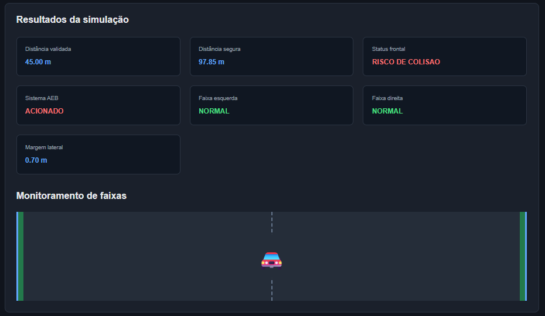

# ADAS Simulator 🚗


Simulador educacional de sistemas avançados de assistência ao motorista (ADAS), desenvolvido com Python, FastAPI, React e PostgreSQL.

A aplicação simula funcionalidades de assistência veicular, processando leituras de sensores, calculando distâncias seguras e identificando possíveis riscos de colisão e invasão de faixa. Os resultados são apresentados em um dashboard interativo e armazenados em um banco de dados para consulta posterior.

## 📸 Demonstração



## 🎯 Objetivo

Desenvolver uma aplicação full stack que simule o funcionamento de alguns recursos presentes em sistemas ADAS, aplicando conceitos de programação, desenvolvimento de APIs, integração entre frontend e backend, persistência de dados e testes automatizados.

## ⚙️ Funcionalidades

- Processamento e validação de leituras de sensores (Radar, LiDAR e câmera).
- Cálculo de distância segura considerando velocidade, tempo de reação e atrito da via.
- Monitoramento da distância frontal e identificação de riscos de colisão.
- Monitoramento de faixas laterais.
- Classificação geral dos níveis de risco.
- Simulação de acionamento do sistema AEB (Automatic Emergency Braking).
- Dashboard interativo para configuração e visualização das simulações.
- Integração entre frontend React e API FastAPI.
- Armazenamento das simulações em banco de dados PostgreSQL.
- Histórico de simulações com visualização detalhada dos registros.
- API REST com validação automática dos dados de entrada.

## 🛠️ Tecnologias utilizadas

**Backend**
- Python
- FastAPI
- Pydantic
- SQLAlchemy
- PostgreSQL
- Uvicorn

**Frontend**
- React
- JavaScript
- CSS
- Vite

**Testes**
- Pytest
- HTTPX

## 📁 Estrutura do projeto

```text
ADAS-Simulator/
│
├── app/
│   ├── __init__.py
│   ├── calculos.py
│   ├── sensores.py
│   ├── sistema.py
│   ├── database.py
│   └── models.py
│
├── tests/
│   ├── test_api.py
│   ├── test_calculos.py
│   ├── test_sensores.py
│   └── test_sistema.py
│
├── frontend/
│   ├── public/
│   ├── src/
│   │   ├── assets/
│   │   ├── App.jsx
│   │   ├── App.css
│   │   ├── index.css
│   │   └── main.jsx
│   ├── package.json
│   └── vite.config.js
│
├── screenshots/
│   └── ADAS-Print.png
│
├── api.py
├── main.py
├── requirements.txt
├── .gitignore
└── README.md
```

## 🚀 Como executar

### 1. Clonar o repositório

```bash
git clone https://github.com/MuriloPb21/ADAS-Simulator.git
cd ADAS-Simulator
```

### 2. Configurar o PostgreSQL

Instale o PostgreSQL e crie um banco de dados chamado:

```sql
CREATE DATABASE adas_simulator;
```

Na pasta principal do projeto, crie um arquivo `.env` com as seguintes configurações:

```env
DB_USER=postgres
DB_PASSWORD=sua_senha
DB_HOST=localhost
DB_PORT=5432
DB_NAME=adas_simulator
```

Substitua `sua_senha` pela senha definida durante a instalação do PostgreSQL.

### 3. Instalar as dependências do backend

```bash
python -m pip install -r requirements.txt
```

### 4. Iniciar o backend

Na pasta principal do projeto:

```bash
python -m uvicorn api:app --reload
```

A API estará disponível em:

`http://127.0.0.1:8000`

Documentação interativa:

`http://127.0.0.1:8000/docs`

### 5. Iniciar o frontend

Abra outro terminal e acesse a pasta:

```bash
cd frontend
```

Instale as dependências:

```bash
npm install
```

Inicie a aplicação:

```bash
npm run dev
```

O frontend estará disponível em:

`http://localhost:5173`

**Importante:** mantenha o backend e o frontend em execução simultaneamente.

## 🧪 Testes automatizados

O projeto possui 28 testes automatizados, cobrindo cálculos, sensores, lógica do sistema ADAS e endpoints da API.

Para executar os testes:

```bash
python -m pytest -v
```

## ⚠️ Observação

Este projeto possui finalidade educacional e de demonstração. Não deve ser utilizado como sistema real de assistência ou segurança veicular.

## 👨‍💻 Autor

Desenvolvido por **Murilo Prado** como projeto de estudo e portfólio, com foco em desenvolvimento full stack, Python, APIs e integração com banco de dados.